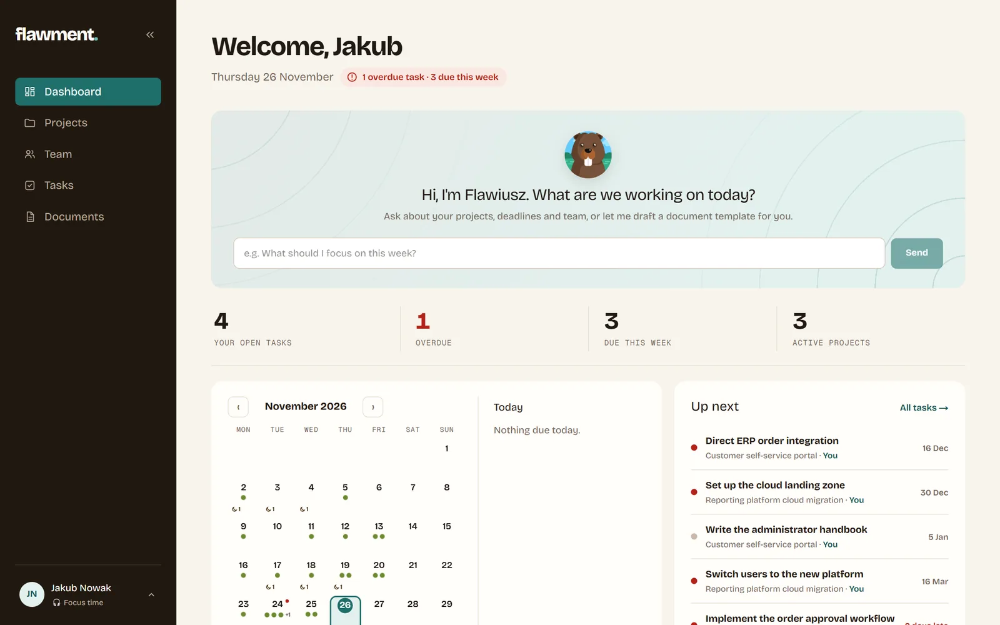
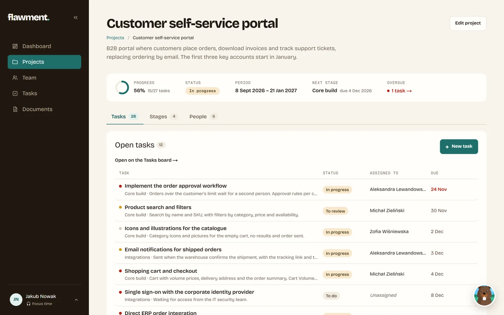
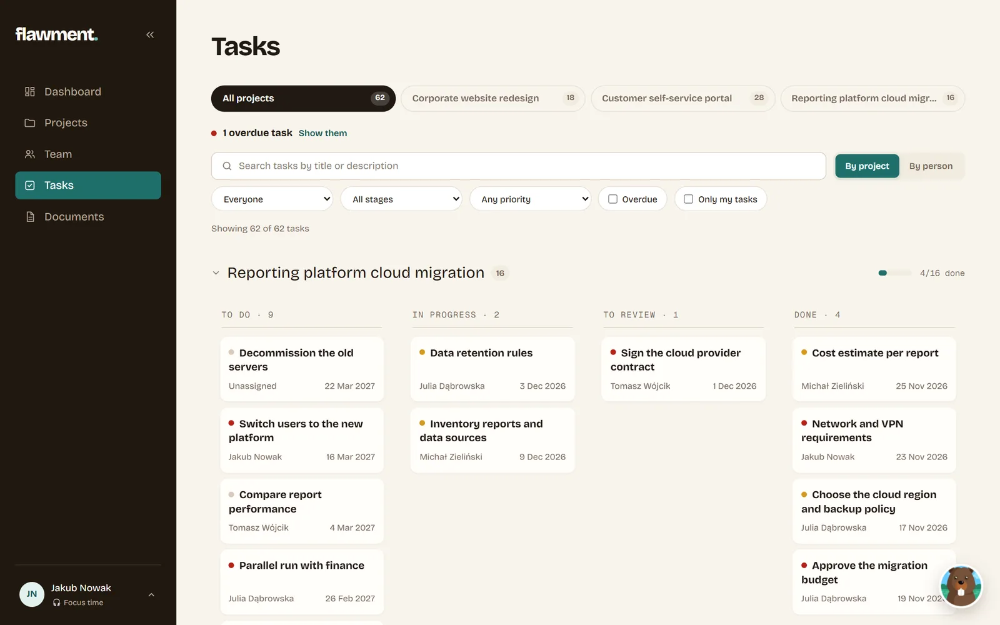
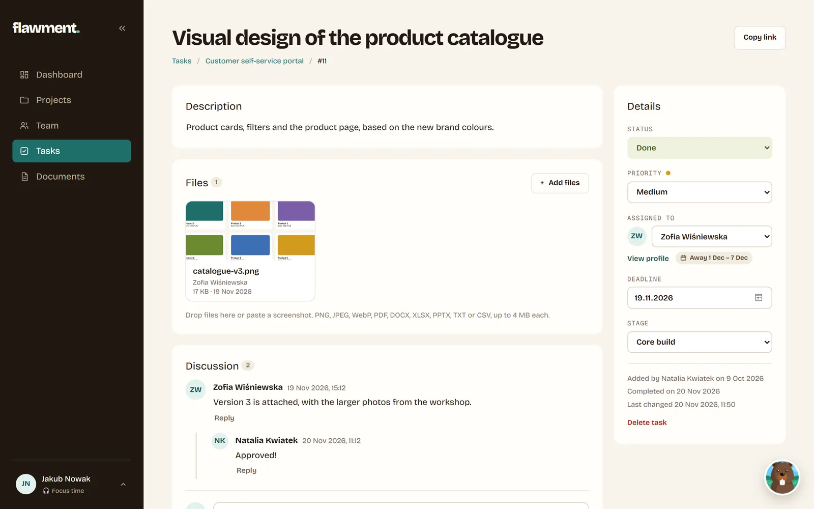
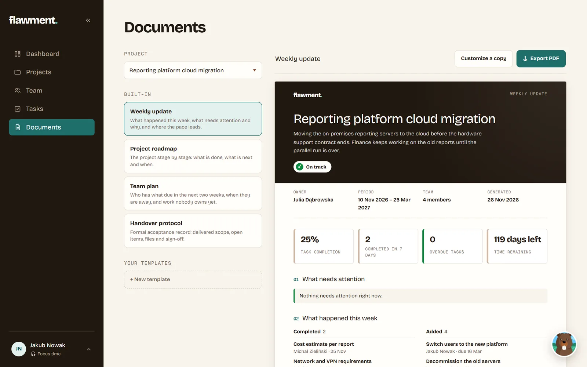

# Flawment

[](https://github.com/natalia-kut/flawment/actions/workflows/ci.yml)
[](https://github.com/natalia-kut/flawment/actions/workflows/codeql.yml)

Flawment is an early-stage project management application built with Next.js 16
(App Router), React 19, TypeScript, Tailwind CSS 4, Prisma 7, and PostgreSQL 17.
Try it at [flawment.vercel.app](https://flawment.vercel.app).

- **Projects and tasks:** stages, a board across projects, task pages with
  comments and files.
- **Documents:** written from a project's live data, with a pace forecast, a stage
  roadmap and a team plan.
- **People and teams:** profiles, statuses, job titles and time off.
- **Flawiusz:** an AI assistant that answers questions about projects, deadlines and
  the team, and creates document templates.



<details>
<summary>More screenshots</summary>

| Project page | Tasks board |
| --- | --- |
|  |  |
| **Task page** | **Documents** |
|  |  |

Shown with the sample data from `npm run db:seed`.

</details>

How it all works is in the **[Wiki](https://github.com/natalia-kut/flawment/wiki)**.

## Quick start

Works on Windows and macOS. Install first:

- [Node.js](https://nodejs.org/) **24 LTS**, including npm. Prisma also supports
  Node.js 20.19+ and 22.12+ on their respective release lines.
- [Docker Desktop](https://www.docker.com/products/docker-desktop/), started and
  ready. On Windows, use Linux containers (the WSL 2 backend is supported).
- Docker Compose v2 supporting `up --wait` (included with current Docker Desktop).

Clone the repository, open a terminal in its root directory, then run:

```sh
npm run bootstrap
npm run dev
```

Bootstrap installs dependencies, creates `.env`, starts PostgreSQL in Docker, applies
migrations and adds a super admin; it is safe to rerun. Open
[http://localhost:3000](http://localhost:3000) and register, or sign in as the local
super admin: `admin@flawment.local` / `FlawmentAdmin123!`.

For sample projects and people, run `npm run db:seed` before anyone registers (it skips
a database that already has users); the sample
people sign in with `flawment123`.

Something not working? See
[Setup and configuration](https://github.com/natalia-kut/flawment/wiki/Setup-and-configuration).

## Commands

| Command | Purpose |
| --- | --- |
| `npm run bootstrap` | Install dependencies, prepare `.env`, start DB, migrate, generate client |
| `npm run dev` | Start the development server |
| `npm run db:up` | Start PostgreSQL and wait for it to be healthy |
| `npm run db:down` | Stop Compose services, keeping database data |
| `npm run db:migrate -- --name describe_change` | Create/apply a migration after editing the Prisma schema |
| `npm run db:deploy` | Apply committed migrations without prompts |
| `npm run db:generate` | Regenerate Prisma Client after schema changes |
| `npm run db:seed` | Add optional sample data to an empty database |
| `npm run db:seed:admin` | Add the super admin to an existing installation |
| `npm run db:demo` | Bring the sample projects up to date with today |
| `npm test` | Run unit tests |
| `npm run test:integration` | Run integration tests against the local database |
| `npm run lint` | Run ESLint |
| `npm run build` | Create a production build |
| `npm run start` | Serve the production build |

After pulling dependency or migration changes, rerun bootstrap. After editing
`prisma/schema.prisma`, run `db:migrate` and then `db:generate`, and commit the
resulting migration.

## Set up Flawiusz

Flawiusz uses the free
[NVIDIA: Nemotron 3.5 Super VL](https://openrouter.ai/nvidia/nemotron-3.5-super-vl)
model through [OpenRouter](https://openrouter.ai/). The app works without Flawiusz;
the chat then shows that the assistant is not set up.

1. Create an API key at [openrouter.ai/settings/keys](https://openrouter.ai/settings/keys).
2. Add these lines to `.env`:

   ```dotenv
   LLM_BASE_URL=https://openrouter.ai/api/v1
   LLM_MODEL=nvidia/nemotron-3.5-super-vl:free
   LLM_API_KEY=sk-or-...
   ```

3. Restart `npm run dev`.
